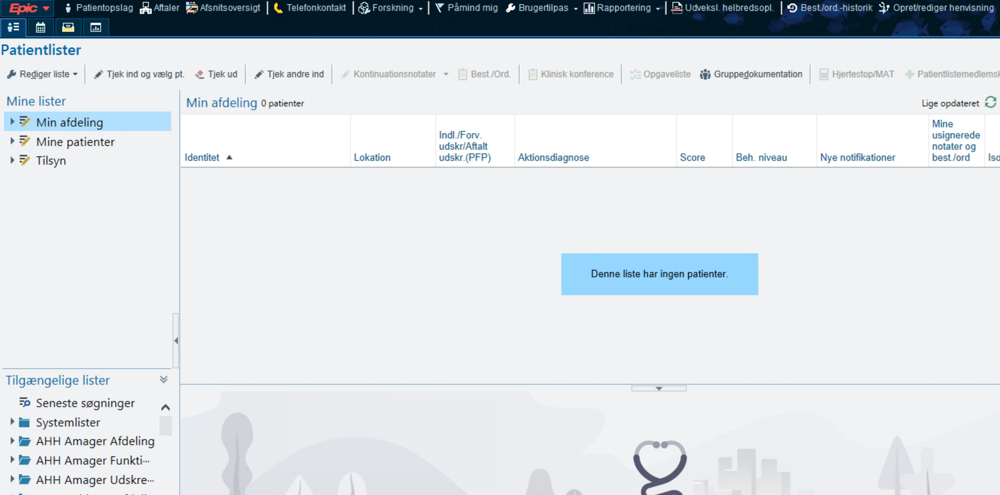
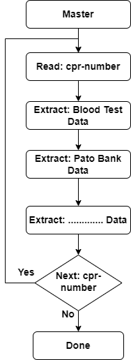

# 🏥 AI-Powered Medical Data Extraction: Epic RPA Suite



**A high-performance Robotic Process Automation (RPA) solution developed in collaboration between Roskilde University (RUC) and the Technical University of Denmark (DTU).**

---

## 📑 Table of Contents
- [🚀 Executive Summary](#-executive-summary)
- [🏗️ System Architecture](#️-system-architecture)
- [🛠️ Technical Deep-Dive](#️-technical-deep-dive)
- [🧩 Functional Modules](#-functional-modules)
- [📋 Prerequisites & Setup](#-prerequisites--setup)
- [📖 Operational Guide](#-operational-guide)
- [🛡️ Security & Compliance](#️-security--compliance)
- [🤝 Contribution & Development](#-contribution--development)

---

## 🚀 Executive Summary

### The Challenge
Clinical research at **RUC** and **DTU** requires the extraction of vast amounts of patient data from the **Epic** Electronic Health Record (EHR) system. Manual extraction is labor-intensive, error-prone, and scales poorly, delaying critical medical insights.

### Our Solution
This project provides an intelligent **RPA (Robotic Process Automation)** suite that simulates human interaction with the Epic desktop client. By leveraging computer vision and optical character recognition (OCR), it automates the end-to-end data lifecycle—from patient search to structured Excel reporting.

### Business Value & Impact
*   **⏱️ 95% Efficiency Increase:** Automates hours of manual data entry in minutes.
*   **🎯 Zero Human Error:** Eliminates copy-paste mistakes, ensuring high-fidelity research data.
*   **💰 Significant ROI:** Reduces operational costs by freeing medical professionals for higher-value tasks.
*   **📈 Scalable Research:** Enables large-scale studies that were previously logistically impossible.

---

## 🏗️ System Architecture

The system follows a **Modular Orchestrator-Plugin** architecture:

1.  **Orchestrator (`open_extract_close_patient.py`):** The "brain" of the operation. It manages the global workflow, iterates through CPR numbers, and handles patient session management (Open/Close).
2.  **Plugin Modules:** specialized scripts located in `master/` subdirectories. Each module is "pluggable" and focuses on a specific medical data domain (e.g., `blood_test`, `medicin`).
3.  **Abstraction Layer (`global_functions.py`):** A robust library of reusable GUI interaction primitives (clicks, scrolls, fuzzy matching).

### Workflow Flowchart


---

## 🛠️ Technical Deep-Dive

### Computer Vision Stack
*   **PyAutoGUI:** Primary driver for GUI automation and keyboard/mouse simulation.
*   **OpenCV (Template Matching):** Used to locate UI elements (buttons, fields) with pixel-perfect precision using image snippets stored in `master/images/`.
*   **Tesseract OCR:** Integrated into the Pathology (PatoBank) module to read dynamic text fields that standard screen-scraping cannot capture.

### Advanced Data Processing
*   **Fuzzy Matching (Levenshtein Distance):** Used to validate OCR results against expected patterns, ensuring robustness against UI rendering variations.
*   **Complex Regex Parsing:** Sophisticated regular expressions are used to structure raw clipboard text from the "Medicine" and "Blood Test" modules.
*   **COM Integration:** Uses `win32com.client` for direct interaction with Microsoft Excel, ensuring high-performance data writing without UI dependencies.

---

## 🧩 Functional Modules

| Module | Description | Key Tech |
| :--- | :--- | :--- |
| **Blood Test** | Multi-page extraction of laboratory results. | Reverse page navigation + Table Scraping |
| **Medicin** | Captures prescription history and dosage details. | `re.DOTALL` Regex Parsing |
| **Pato Bank** | Extracts complex pathology reports. | OCR + Levenshtein Distance |
| **MIBA** | Microbiology data structuring. | Pandas-based heuristic cleaning |
| **Vitale** | Vital signs (blood pressure, HR, etc.) tracking. | DateTime normalization |
| **Notater** | Exports clinical notes to PDF format. | OS-level file management & print simulation |
| **Diagnose** | Structured export of patient diagnoses. | Tabular data parsing |

---

## 📋 Prerequisites & Setup

### Environment
*   **OS:** Windows (Required for Epic Client & win32com)
*   **Python:** 3.8+
*   **OCR:** [Tesseract OCR](https://github.com/tesseract-ocr/tesseract) must be installed.

### Installation
1.  Clone the repository.
2.  Install dependencies:
    ```bash
    pip install -r master/requirements.txt
    ```
    *Note: Dependencies include `pyautogui`, `opencv-python`, `pytesseract`, `pandas`, `pyperclip`, `keyboard`, and `pywin32`.*

---

## 📖 Operational Guide

### 1. Data Preparation
Create an Excel file named `cprs.xlsx` in the `master/` folder.
*   **Column A:** Header "cpr"
*   **Data:** List CPR numbers in `XXXXXX-XXXX` format.

### 2. Launching the Suite
1.  Open the **Epic** application and navigate to the home dashboard.
2.  Open a terminal in the project root.
3.  Run the orchestrator:
    ```bash
    python master/open_extract_close_patient.py
    ```

### 3. Output
Structured data will be saved in `Documents/HospitalData/` categorized by patient CPR number.

---

## 🛡️ Security & Compliance

*   **Danish Board of Health Approved:** Conducted with full regulatory oversight.
*   **Data Privacy:** No patient data is stored within the script itself. All processing happens in-memory or within the user's secure local environment.
*   **Auditability:** Standard logging (found in `master/log/`) tracks process success and failures without exposing sensitive PHI.

---

## 🤝 Contribution & Development

We welcome contributions! To add a new extraction module:

1.  **Create a folder** in `master/` for your module.
2.  **Use `global_functions.py`** to handle GUI interactions.
3.  **Capture UI snippets** and store them in the module's `images/` subfolder.
4.  **Register your module** in `master/open_extract_close_patient.py`.

---
*Developed for clinical excellence by RUC & DTU.*
