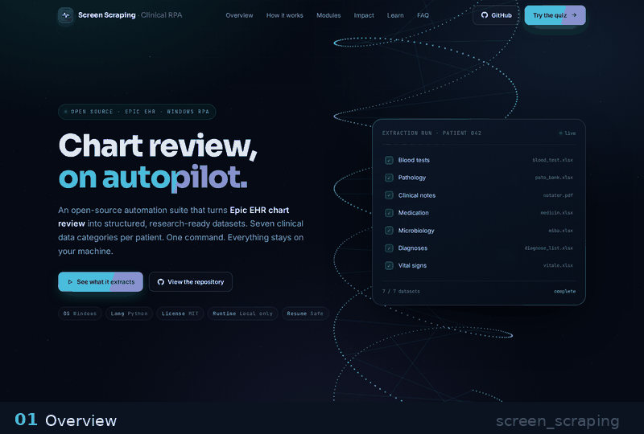
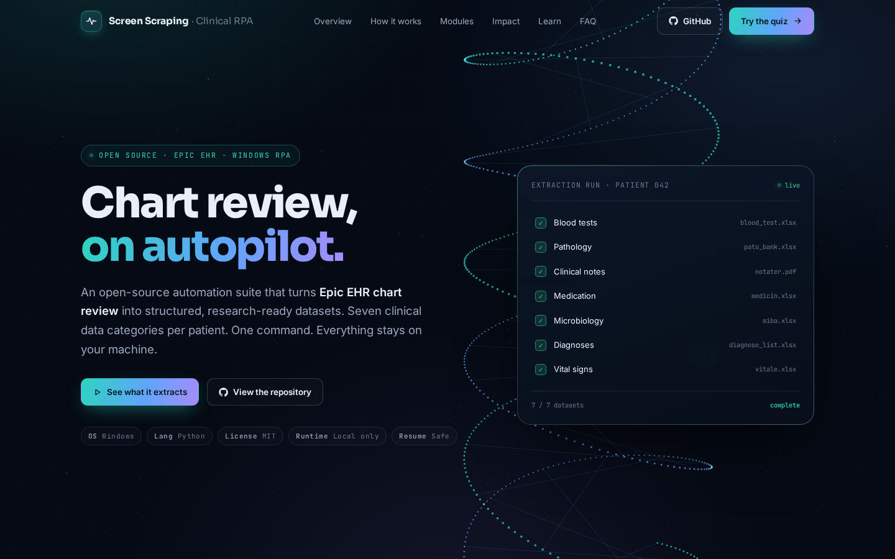
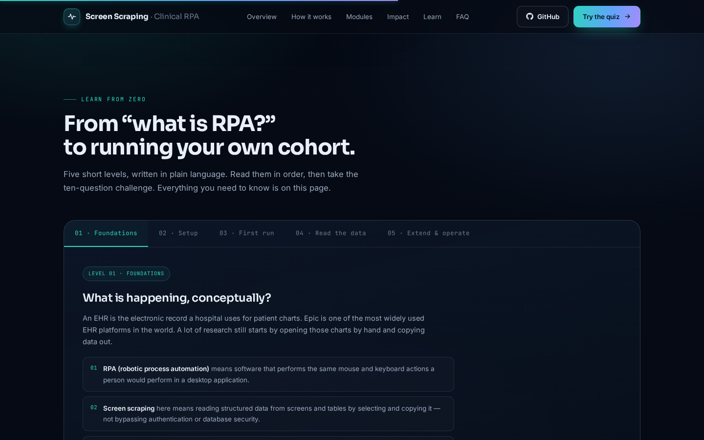
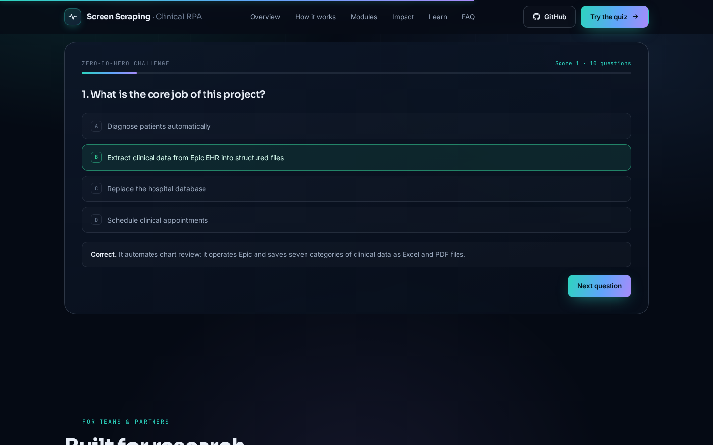
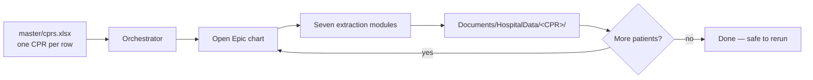

# 🏥 Screen Scraping — Clinical Data Automation for Epic EHR

### Chart review, on autopilot. Seven clinical datasets per patient. One command.

[](#requirements)
[](#requirements)
[](LICENSE)
[](#the-seven-datasets)
[](https://m0-ar.github.io/screen_scraping/)

<p align="center">
  <a href="https://m0-ar.github.io/screen_scraping/">
    
  </a>
</p>

## Summary

**Screen Scraping is an open-source Windows automation suite that turns Epic EHR chart review into structured, research-ready datasets.** It operates the Epic desktop client the same way a trained user would: it searches for a patient, opens the chart, extracts seven categories of clinical data, writes each category to a clean Excel or PDF file, closes the chart, and moves on to the next patient.

Everything runs locally on the workstation that already has access to Epic. There is no cloud service, no database migration, and no integration project to schedule. If a run is interrupted, it resumes safely: patients whose files already exist are skipped, so a partially completed cohort can continue where it stopped.

The result is a per-patient folder of consistent, analysis-ready files — the same fields, the same format, the same rules for every patient in the cohort.

> [!TIP]
> **New to all of this?** Read the [🌱 Beginner Guide](#-beginner-guide--read-this-and-you-are-a-professional). You will know more than most interview candidates by the end.

---

## The problem, in one minute

Clinical research still begins, very often, with a person opening charts by hand. For every patient, someone navigates to the same tabs, copies the same tables, pastes them into the same spreadsheet, and repeats. It is slow, it does not scale, and every manual copy introduces a chance of transcription error.

This project removes that loop. It is built for the part of research that is repetitive but too important to rush.

| The manual reality | What the suite changes |
| :--- | :--- |
| Hours of clicking through charts per patient | One run processes a whole CPR list unattended |
| Copy-paste drift between patients | Identical extraction rules for every chart |
| Work stops when the person stops | Resume-safe runs continue after interruptions |
| Data spread across ad-hoc spreadsheets | One predictable folder per patient, seven standard files |
| Sensitive data pushed through external tools | Everything stays on the local machine |

Prefer to see it before reading? **[Open the interactive preview →](https://m0-ar.github.io/screen_scraping/)**

---

## Who it is for

- **Clinical research teams** building retrospective cohorts without waiting for a data-warehouse project.
- **Registries and quality teams** that need the same extraction logic applied consistently over time.
- **Health-informatics educators** looking for a realistic, readable RPA codebase to teach from.
- **Automation builders** who want a working pattern for driving a desktop clinical application safely.

It is not a diagnostic tool, not a medical device, and not a replacement for clinical judgment. It is a careful pair of robot hands for work that should never have been manual in the first place.

---

## See it in action

The landing page includes a five-level learning path, a ten-question challenge, and an interactive savings calculator — all running in the browser with no data collection.

[](https://m0-ar.github.io/screen_scraping/)

| Learn from zero | Test yourself |
| :---: | :---: |
| [](https://m0-ar.github.io/screen_scraping/#learn) | [](https://m0-ar.github.io/screen_scraping/#quiz) |

**[Start the guided experience →](https://m0-ar.github.io/screen_scraping/)**

---

## How it works



The architecture is deliberately simple: one orchestrator, seven independent modules, and a shared helper layer.

- **Orchestrator** — `master/open_extract_close_patient.py`. Reads the CPR list, validates each number, opens and closes charts, calls each module, and decides whether a patient can be skipped.
- **Modules** — one folder per clinical data category. Each module owns its clicks, its parsing, and its output file.
- **Shared helpers** — `master/global_functions.py`. Template matching clicks, clipboard access, fuzzy distance, Excel writing, window handling, and logging.

Because modules are independent, you can run the full suite or adapt a single extractor for a narrower job.

---

## The seven datasets

| Dataset | Module folder | Output | What it captures |
| :--- | :--- | :--- | :--- |
| Blood tests | `blood_test` | `blood_test.xlsx` | Laboratory results across paginated tables, collected page by page |
| Pathology | `pato_bank` | `pato_bank.xlsx` | Pathology reports located by REKV number; OCR plus fuzzy matching for dynamic text |
| Clinical notes | `notater` | `notater.pdf` | Notes exported through the print pipeline into a single PDF per patient |
| Medication | `medicin` | `medicin.xlsx` | Medication history with `Medication`, `Start-Date`, and `End-Date` columns |
| Microbiology | `miba` | `miba.xlsx` | Sample type, collection date, quantity, analyses, resistance, and microscopy |
| Diagnoses | `diagnose_liste` | `diagnose_list.xlsx` | Diagnosis text and date, captured from the overview table |
| Vital signs | `vitale` | `vitale.xlsx` | Latest values plus date-stamped measurement columns for trend analysis |

### Output layout

```text
Documents/
└── HospitalData/
    └── 250190-1234/          # one folder per patient, named by CPR
        ├── blood_test.xlsx
        ├── pato_bank.xlsx
        ├── notater.pdf
        ├── medicin.xlsx
        ├── miba.xlsx
        ├── diagnose_list.xlsx
        └── vitale.xlsx
```

A patient is skipped only when **all seven files already exist**. Delete a file to re-extract just that dataset on the next run.

---

## Quick start

### Requirements

- **Windows** — required for the Epic desktop client and Excel automation.
- **Python 3.8+**
- **Epic EHR desktop client**, already signed in on the machine.
- **Tesseract OCR** — used by the pathology module. Install it, then confirm the executable path in `master/pato_bank/extract_rekav_data_by_number.py` matches your installation.
- **Microsoft Excel** — installed locally for the COM-based workbook writing.

### Three steps

**1 · Install the Python dependencies** from the repository root:

```bash
pip install -r requirements.txt
```

**2 · Prepare the patient list.** Open `master/cprs.xlsx` and put one CPR number per row in column A, in `XXXXXX-XXXX` format. Keep the file at that exact path.

**3 · Run the orchestrator** from the repository root, with Epic open in the background:

```bash
python master/open_extract_close_patient.py
```

Sit back. The suite opens each chart, extracts what it can, writes the files, and moves on. Results appear in `Documents/HospitalData/<CPR>/`.

> [!IMPORTANT]
> Run the command **from the repository root**, not from inside `master/`. All input, image-template, and log paths are resolved relative to the working directory.

<details>
<summary><strong>Troubleshooting the first run</strong></summary>

- **`ModuleNotFoundError`** — run `pip install -r requirements.txt` again from the repository root and confirm you are using the same Python environment.
- **Tesseract “not installed or not in PATH”** — set the full path to `tesseract.exe` in `master/pato_bank/extract_rekav_data_by_number.py`.
- **Nothing happens when a module starts** — Epic may not be the active window, or the interface language/layout differs from the reference images in `master/images/`.
- **`DataFrame.append` error** — the vital-signs module targets older pandas. Keep `pandas<2.0` as pinned in `requirements.txt`.
- **A patient is skipped unexpectedly** — all seven files already exist. Remove the specific file you want to regenerate.
- **A CPR is rejected** — verify the exact `XXXXXX-XXXX` format. The orchestrator validates the pattern before typing it.

</details>

---

## 🌱 Beginner Guide — Read this and you are a professional.

No prior automation knowledge is assumed. If you can install an application and edit a spreadsheet, you can follow this.

### 1. What is an EHR, and what is Epic?

An **EHR** (electronic health record) is the digital chart a hospital uses for a patient: notes, lab results, medication, diagnoses, vital signs, and more. **Epic** is one of the most widely used EHR platforms in the world. Hospitals configure it heavily, so every Epic installation looks a little different.

### 2. What is RPA?

**RPA** (robotic process automation) means software that performs the same mouse and keyboard actions a person would perform in a desktop application. It does not need a special API, a database password, or a server integration. It sees the screen, finds the right button, clicks it, and reads what appears — exactly like a trained user, only faster and more consistent.

### 3. What does this project actually do?

Think of it as a careful assistant with a checklist:

1. Read the next CPR number from an Excel list.
2. Open that patient's chart in Epic.
3. Visit seven data areas and copy what is there.
4. Save each area as its own file in a folder named after the patient.
5. Close the chart and repeat for the next patient.

If the assistant is interrupted, it checks which files already exist and continues from there.

### 4. What you need before your first run

- A Windows computer with Epic installed and signed in.
- Python installed (3.8 or newer).
- Tesseract OCR installed for the pathology module.
- Excel installed.
- Permission to automate the Epic environment you are using. **This is not optional** — see [Privacy, safety & compliance](#privacy-safety--compliance).

### 5. Your first run, step by step

1. Open a terminal in the repository folder.
2. Run `pip install -r requirements.txt` and wait for it to finish.
3. Open `master/cprs.xlsx` and enter one test CPR number in column A.
4. Open Epic and leave it on the patient-search screen.
5. Run `python master/open_extract_close_patient.py`.
6. Watch the first patient complete end to end before adding a full cohort.
7. Check every output file by hand against the chart. Trust is earned one patient at a time.

### 6. How to read the output files

- **`.xlsx` files** open in Excel. Each row is a record; each column is a field. The exact columns are listed in [The seven datasets](#the-seven-datasets).
- **`notater.pdf`** contains the clinical notes exactly as printed from Epic.
- **`HospitalData/<CPR>/`** is self-contained. You can copy one patient folder without touching the rest.

### 7. Five things that trip up beginners

1. **Wrong working directory.** Run from the repository root; paths are relative.
2. **CPR format.** `XXXXXX-XXXX`, with the hyphen included.
3. **Epic in the background.** Bring the Epic window to the front before starting.
4. **Tesseract path.** The pathology module expects a local install; update its path if yours differs.
5. **Assuming outputs are perfect.** OCR and UI automation can misread. Validate before research use.

### 8. Glossary

| Term | Meaning |
| :--- | :--- |
| **CPR** | The Danish personal identification number, used here as the patient key |
| **EHR** | Electronic health record — the digital patient chart |
| **Epic** | The EHR platform this suite automates |
| **RPA** | Robotic process automation — software that drives a desktop UI |
| **OCR** | Optical character recognition — turning pixels of text into real text |
| **Template matching** | Finding a button or field by comparing a small reference image with the screen |
| **Levenshtein distance** | A similarity score between two strings, used to validate fuzzy OCR output |
| **Orchestrator** | The main script that loops over patients and calls the modules |
| **Resume-safe** | Rerunning skips work that is already complete |

---

## Under the hood

The suite combines four techniques:

- **Computer vision** — template images stored under `master/images/` are matched against the screen to locate buttons, fields, and tabs. This is why layout changes can require new reference images.
- **Clipboard-based extraction** — tables are selected and copied, then parsed as structured text. It is faster and more faithful than reading pixels one character at a time.
- **OCR with fuzzy validation** — pathology text is read with Tesseract and checked with Levenshtein distance, so small rendering differences do not silently corrupt a field.
- **Excel COM automation** — workbooks are written through `win32com`, avoiding manual save dialogs and UI-dependent file handling.

### Repository map

```text
master/
├── open_extract_close_patient.py   # orchestrator
├── global_functions.py             # shared helpers
├── cprs.xlsx                       # input list (column A)
├── images/                         # UI reference templates
├── blood_test/
├── pato_bank/
├── notater/
├── medicin/
├── miba/
├── diagnose_liste/
└── vitale/
```

Logs are written under `master/log/`. They record success and failure events without embedding patient data in the code.

---

## Impact model (illustrative)

There is no universal savings number. Throughput depends on chart size, network speed, OCR, hardware, and how many datasets a patient actually has. Instead of a marketing claim, the [interactive preview](https://m0-ar.github.io/screen_scraping/#impact) includes a calculator you can set to your own baseline:

```text
hours returned per month = patients/month × (manual minutes − automated minutes) ÷ 60
value per month          = hours returned × staff cost per hour
```

With the calculator's default example — 200 patients per month, 25 manual minutes versus 3 automated minutes, and a staff cost of 250 per hour — the model shows roughly **73 hours and 18,333 per month**. That is an illustration, not a promise. Measure your own workflow before quoting a number to anyone.

---

## Privacy, safety & compliance

Automating a clinical system is not a toy. These principles are part of the design:

- **Authorization first.** Use the suite only on systems you are explicitly permitted to automate, with approval from the system owner.
- **Local by default.** No cloud service, no telemetry, no upload. Data is written to the local `Documents` folder.
- **Run logs stay local.** `master/log/` is excluded from version control because log lines can contain CPR numbers. Keep logs on the workstation and handle them under your retention policy.
- **Human review required.** Extracted data must be validated before research use. Automation reduces effort; it does not certify accuracy.
- **Compliance stays with the institution.** GDPR, research ethics, retention rules, and Epic's terms of use remain the responsibility of the deploying organization.
- **No certification claims.** This repository is not a medical device and does not claim regulatory approval. Any pilot should follow your institution's data-protection and security review.
- **Screenshots in this repository** were reviewed and contain no patient data. The Epic view shown is an empty patient list.

If you are unsure whether your intended use is permitted, stop and ask your data owner before running anything.

---

## Roadmap

Planned, in no particular order and with no promised dates:

- Configurable module registry and a safer dry-run mode.
- Externalized UI templates and clearer selector diagnostics.
- Packaging for non-developer machines.
- English/Danish column-header options for outputs.
- More automated tests around parsing and resume behavior.

Ideas and use cases are welcome in [Issues](https://github.com/M0-AR/screen_scraping/issues).

---

## Contributing

Contributions are welcome, especially from people who run the suite on real Epic layouts.

To add a new extraction module:

1. Create a folder under `master/`.
2. Use `master/global_functions.py` for clicks, clipboard work, and Excel output.
3. Capture the UI reference images your module needs and keep them in its own `images/` folder.
4. Register the module in `master/open_extract_close_patient.py`, including its output file in the resume check.

Please keep changes focused, avoid committing patient data or local logs, and describe how you tested the change on a non-production environment.

---

## License

Released under the [MIT License](LICENSE). You may use, modify, and distribute the code with attribution. The software is provided **as is**, without warranty of any kind.

---

## Acknowledgements

The workflow originated in a clinical-research setting at **Roskilde University (RUC)** and the **Technical University of Denmark (DTU)**, where extracting research data from Epic by hand was a recurring bottleneck. This repository is an independent, open-source implementation.

Not affiliated with or endorsed by Epic Systems Corporation. Epic is a trademark of Epic Systems Corporation.

---

### Evaluating the suite for your organization?

Open an [issue](https://github.com/M0-AR/screen_scraping/issues/new) with your scenario — cohort size, datasets needed, Epic layout, and constraints. Responsible pilots start with one patient and a human check on every file.
